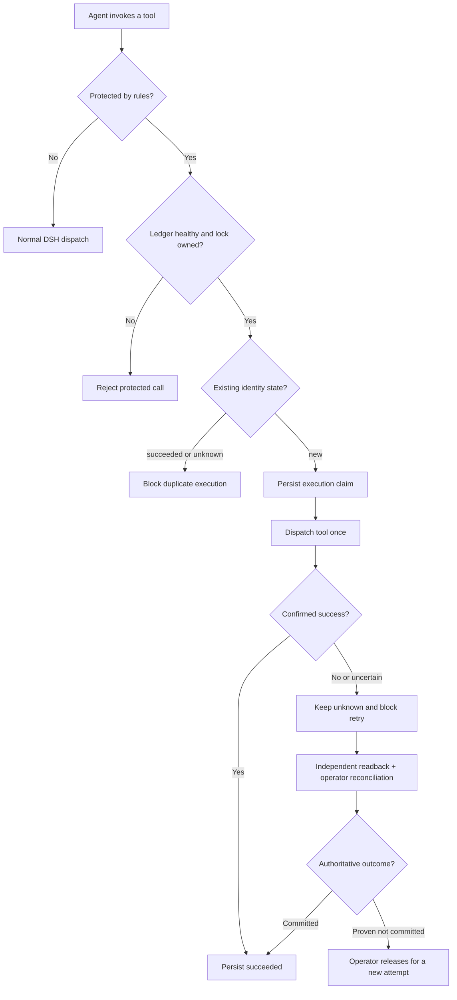

<h1 align="center">SKY Evidence Recovery</h1>

<p align="center"><strong>Durable evidence-backed recovery for opt-in DeepSeek Harness tools</strong></p>

<p align="center">
  <a href="docs/RELEASE_NOTES.md"></a>
  
  
  <a href="LICENSE"></a>
  
</p>

<p align="center">
  <a href="README.en.md">English</a> ·
  <a href="README.md">简体中文</a> ·
  <a href="README.ko.md">한국어</a> ·
  <a href="README.ja.md">日本語</a>
</p>

A lightweight **DeepSeek Harness (DSH)** plugin that persists the identity of a protected operation **before dispatch**. When a response is lost or a tool times out, fails, or leaves an uncertain outcome, the agent cannot blindly repeat the same side effect. Independent readback and trusted operator reconciliation determine the next step.

**Not an exactly-once system.** Only tools explicitly listed in `rules` are protected; an empty rule set protects nothing.

## Quickstart

In DSH Web, open Settings → SKY Evidence Recovery to check protection, review pending records, and prepare evidence for offline reconciliation. See the [operator guide](README.md#操作者恢复) for file-free review, business ID lookup, and lock diagnostics.

1. Extract the matching source ZIP and install from its directory with `dsh plugin --profile sky-evidence-smoke add "file:$($PWD.Path)"`.
2. [Configure a rule](#install-and-try). Call `sky_recovery_health` after startup and check the lock, the protected tool and `invalidRules: []`.
3. On `SKY_EXECUTION_UNKNOWN`, use `node admin.js list --pending --data-dir $ledgerDir` from the trusted operator terminal. Then [inspect, verify and preview reconciliation](README.md#操作者恢复).

## Validated in an actual DSH installation (0.1.3-beta.4)

This build was **installed and loaded in a running DSH Desktop/Web host** via `file:`, rather than tested solely against a mock host. A live `sky_recovery_health` call returned `loaded: true`, `ledgerLocked: true`, and `protectedTools: []`; the demo order tool was `unprotected`, as expected with the default empty `rules` configuration. **Installation alone does not enable protection.**

The user also reports **11 tool calls resulting in five persisted demo orders and no duplicates** from their installed DSH instance. This is reported firsthand usage, not an independently archived trace of those 11 calls. The **DSH host and invocation chain were real; the order side effects were simulated**, not actual payment or refund transactions.

The external Windows acceptance report records **57/57** package tests, **89/89** DSH ToolRuntime assertions, **5/5** model A–E scenarios (10 tool calls), **60/60** simulated business scenarios (110 attempts, 60 simulated side effects, 50 blocked duplicates), and a working DSH Web status panel. [Public evidence](docs/Public_Evidence_0.1.3-beta.4.zip) is a redacted field projection, **not raw logs**. The R30 community-plugin combination and R16 runtime injection remain unverified.

**Operator CLI distribution limitation:** `admin.js` is in the **matching full source archive**, but intentionally absent from the installed npm/DSH runtime package. Users installing only that package cannot run reconciliation from its `node_modules` directory. Obtain the same-version full source and run `node admin.js ...` in a trusted, separate operator terminal after stopping DSH. This package boundary is **not a security boundary**; do not give the agent arbitrary shell, file-write, or plugin-management permissions. A separate operator CLI distribution is a future improvement.

## Features

- **Durable ledger:** stores hashed business identities, argument fingerprints, execution attempts and outcome states across restarts.
- **Duplicate protection:** a confirmed success becomes `succeeded`; uncertain outcomes stay `unknown` and block retries.
- **Fail-closed behavior:** rejects protected calls when the ledger or owned lock is unavailable or tampered with.
- **Evidence-based recovery:** a trusted operator reconciles results using independent downstream evidence; a tool's error code is not proof that no side effect occurred.
- **Health checks:** use `sky_recovery_health` and `sky_recovery_status` to inspect the active guard and records.

## Install and try

Requires the DSH 0.2 prerelease line (tested versions below) and Node.js ≥24.9.0. Install in an isolated profile:

```powershell
dsh plugin --profile sky-evidence-smoke add "file:$($PWD.Path)"
```

`cordis.patch.yml` defaults to `rules: []`. **Installation alone does not protect any tool.** Configure an explicit rule:

```yaml
- id: sky-evidence-recovery
  config:
    rules:
      - tool: sky_demo_create_order
        keyArg: requestId
```

The example also requires the included `sky-evidence-recovery/demo` tool. On Windows, run `启动DSH测试.cmd` for an **isolated config preflight**; Web is not started by default. After startup, actually call `sky_recovery_health` and confirm `loaded=true`, `ledgerLocked=true`, and the intended `protectedTools`. See the [integration guide](DSH_接入验收.md) (Chinese).

<details>
<summary><strong>Technical flow and design notes (expand)</strong></summary>



- The claim is durably recorded **before** the tool body runs.
- Only a confirmed success is marked `succeeded`. Uncertain outcomes remain `unknown`; read-only queries never clear the guard automatically.
- Reconciliation is an offline, operator-only action after authoritative readback. Re-execution is allowed only when a previous commit and late commit have both been ruled out.
- If the plugin never activates, it cannot enforce protection; the host must separately gate protected tools.

</details>

## Verification and scope

See the [issue and fix log](问题与修复记录.md) for fresh `0.1.2` checks. The table below records the earlier acceptance of internal candidate `0.1.4-beta.1` for the first public version, `0.1.1`.

| Check | Reported result |
|---|---|
| Windows `npm run check` | 46 PASS, 0 FAIL, 0 SKIP |
| Windows PowerShell 5.1 / CMD | 7 PASS |
| Real DSH ToolRuntime | 91 deduplicated assertions PASS; R30 plugin combination BLOCKED |
| Real Web model A–E | 5 scenarios PASS, 10 real tool calls |
| Package dry run | PASS, 13 runtime package files |

R16 real-runtime settlement-disk-failure injection was not run; macOS/Linux, multiple instances, cross-host deployment, real downstream operations and hard power loss were not verified. These are results supplied by the independent acceptance report; not all raw sessions are publicly included. See the [final acceptance report](docs/FINAL_TEST_REPORT.md).

## Security and project records

The agent must not have arbitrary same-identity shell, file-write or plugin-management access, or it may bypass the ledger. The host must enforce guard activation. This is a **single-process**, opt-in guard and does not provide exactly-once execution.

[Security scope](docs/SECURITY.md) · [Development and fixes log](问题与修复记录.md) (Chinese) · [Release notes](docs/RELEASE_NOTES.md) · [Code standards](DSH_PLUGIN_CODE_STANDARDS.md) · [Apache-2.0](LICENSE)

**Disclaimer:** Independent community project, not an official DeepSeek Harness plugin or endorsed by DeepSeek.
