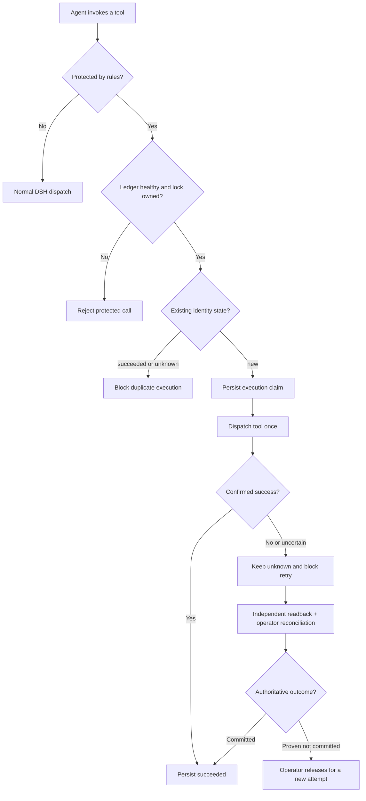

<h1 align="center">SKY Evidence Recovery</h1>

<p align="center"><strong>Durable evidence-backed recovery for opt-in DeepSeek Harness tools</strong></p>

<p align="center">
  <a href="docs/RELEASE_NOTES.md"></a>
  
  
  <a href="LICENSE"></a>
  
</p>

<p align="center">
  <a href="README.en.md">English</a> ·
  <a href="README.md">简体中文</a> ·
  <a href="README.ko.md">한국어</a> ·
  <a href="README.ja.md">日本語</a>
</p>

A lightweight **DeepSeek Harness (DSH)** plugin that persists the identity of a protected operation **before dispatch**. When a response is lost or a tool times out, fails, or leaves an uncertain outcome, the agent cannot blindly repeat the same side effect. Independent readback and trusted operator reconciliation determine the next step.

**Not an exactly-once system.** Only tools explicitly listed in `rules` are protected; an empty rule set protects nothing.

## Features

- **Durable ledger:** stores hashed business identities, argument fingerprints, execution attempts and outcome states across restarts.
- **Duplicate protection:** a confirmed success becomes `succeeded`; uncertain outcomes stay `unknown` and block retries.
- **Fail-closed behavior:** rejects protected calls when the ledger or owned lock is unavailable or tampered with.
- **Evidence-based recovery:** a trusted operator reconciles results using independent downstream evidence; a tool's error code is not proof that no side effect occurred.
- **Health checks:** use `sky_recovery_health` and `sky_recovery_status` to inspect the active guard and records.

## Install and try

Requires the DSH 0.2 prerelease line (tested versions below) and Node.js ≥24.9.0. Install in an isolated profile:

```powershell
dsh plugin --profile sky-evidence-smoke add "file:$($PWD.Path)"
```

`cordis.patch.yml` defaults to `rules: []`. **Installation alone does not protect any tool.** Configure an explicit rule:

```yaml
- id: sky-evidence-recovery
  config:
    rules:
      - tool: sky_demo_create_order
        keyArg: requestId
```

The example also requires the included `sky-evidence-recovery/demo` tool. On Windows, run `启动DSH测试.cmd` for an **isolated config preflight**; Web is not started by default. After startup, actually call `sky_recovery_health` and confirm `loaded=true`, `ledgerLocked=true`, and the intended `protectedTools`. See the [integration guide](DSH_接入验收.md) (Chinese).

<details>
<summary><strong>Technical flow and design notes (expand)</strong></summary>



- The claim is durably recorded **before** the tool body runs.
- Only a confirmed success is marked `succeeded`. Uncertain outcomes remain `unknown`; read-only queries never clear the guard automatically.
- Reconciliation is an offline, operator-only action after authoritative readback. Re-execution is allowed only when a previous commit and late commit have both been ruled out.
- If the plugin never activates, it cannot enforce protection; the host must separately gate protected tools.

</details>

## Verification and scope

The final DSH acceptance dated 2026-11-05 covered the **same runtime logic** under the internal candidate name `0.1.4-beta.1`. `0.1.1` is the first public release label; historical test version identifiers and hashes remain unchanged for traceability.

| Check | Reported result |
|---|---|
| Windows `npm run check` | 46 PASS, 0 FAIL, 0 SKIP |
| Windows PowerShell 5.1 / CMD | 7 PASS |
| Real DSH ToolRuntime | 91 deduplicated assertions PASS; R30 plugin combination BLOCKED |
| Real Web model A–E | 5 scenarios PASS, 10 real tool calls |
| Package dry run | PASS, 13 runtime package files |

R16 real-runtime settlement-disk-failure injection was not run; macOS/Linux, multiple instances, cross-host deployment, real downstream operations and hard power loss were not verified. These are results supplied by the independent acceptance report; not all raw sessions are publicly included. See the [final acceptance report](docs/FINAL_TEST_REPORT.md).

## Security and project records

The agent must not have arbitrary same-identity shell, file-write or plugin-management access, or it may bypass the ledger. The host must enforce guard activation. This is a **single-process**, opt-in guard and does not provide exactly-once execution.

[Security scope](docs/SECURITY.md) · [Development and fixes log](问题与修复记录.md) (Chinese) · [Release notes](docs/RELEASE_NOTES.md) · [Code standards](DSH_PLUGIN_CODE_STANDARDS.md) · [Apache-2.0](LICENSE)

**Disclaimer:** Independent community project, not an official DeepSeek Harness plugin or endorsed by DeepSeek.
