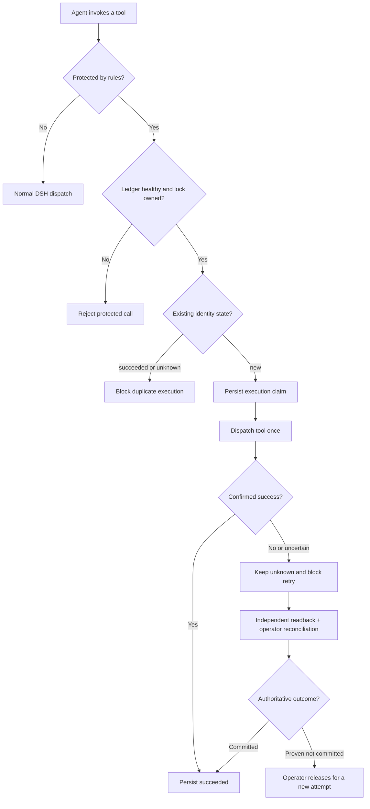

<h1 align="center">SKY Evidence Recovery</h1>

<p align="center"><strong>Durable evidence-backed recovery for opt-in DeepSeek Harness tools</strong></p>

<p align="center">
  <a href="docs/RELEASE_NOTES.md"></a>
  
  
  <a href="LICENSE"></a>
  
</p>

<p align="center">
  <a href="README.en.md">English</a> ·
  <a href="README.md">简体中文</a> ·
  <a href="README.ko.md">한국어</a> ·
  <a href="README.ja.md">日本語</a>
</p>

**DeepSeek Harness（DSH）** のツール実行を保護する軽量プラグインです。対象ツールの実行**前**に操作 ID を永続記録します。応答の消失、タイムアウト、例外などで結果が不明な場合は同じ副作用の安易な再実行を止め、独立した結果照会と管理者による照合を経て次の操作を判断します。

**Exactly-once は保証しません。** 保護されるのは `rules` に明示したツールだけです。初期設定の `rules: []` では何も保護されません。

## クイックスタート

DSH Web の「設定 → SKY Evidence Recovery」で保護状態や照合待ちの記録を確認し、オフライン照合用の証拠を作成できます。

1. 同じバージョンのソース ZIP を展開し、そのディレクトリで `dsh plugin --profile sky-evidence-smoke add "file:$($PWD.Path)"` を実行します。
2. [保護ルールを設定](#インストールと試用)し、起動後に `sky_recovery_health` でロック、対象ツール、`invalidRules: []` を確認します。
3. `SKY_EXECUTION_UNKNOWN` が出たら、管理者端末で `node admin.js list --pending --data-dir $ledgerDir` を実行します。続いて[記録の確認、独立した照会、照合のプレビュー](README.md#操作者恢复)を行います。

## 実際の DSH へのインストールと動作検証（0.1.3-beta.4）

今回はモック環境だけではなく、稼働中の **DSH Desktop/Web に `file:` でインストールし、プラグインのロードを確認**しました。`sky_recovery_health` は `loaded: true`、`ledgerLocked: true`、`protectedTools: []` を返し、デモ注文ツールの状態は `unprotected` でした。これは初期設定 `rules: []` の期待動作です。**インストールしただけでは保護は有効になりません。**

利用者からは、インストール済みの DSH 上で **11 回のツール呼び出しから 5 件のデモ注文が保存され、重複は 0 件**だったとの報告もあります。この 11 回分の原始ログは公開証拠には別途収録されていません。**DSH のホストとツール呼び出しは実環境**ですが、**注文は模擬的な副作用**であり、実際の決済・返金を検証したものではありません。

外部 Windows 検証報告では、テスト **57/57**、DSH ToolRuntime **89/89**、実モデル A–E **5/5**（ツール呼び出し 10 回）、模擬業務シナリオ **60/60**（呼び出し試行 110 回、模擬副作用 60 回、重複防止 50 回）、DSH Web 状態パネルの動作が報告されています。[公開証拠](docs/Public_Evidence_0.1.3-beta.4.zip) は匿名化したフィールドの抜粋であり、生ログではありません。R30 と R16 に関する一部検証は未実施です。

**管理用 CLI の配布上の制約:** `admin.js` は**同一バージョンの完全なソース**に含まれますが、npm/DSH ランタイムパッケージには含まれません。インストール先の `node_modules` から直接実行するとファイルが見つかりません。DSH の停止後、信頼できる別の管理者端末で同一バージョンのソースから `node admin.js ...` を実行してください。パッケージから除外すること自体はセキュリティ境界ではありません。管理用 CLI の別配布は今後の改善事項です。

## 主な機能

- **永続実行台帳：** 業務 ID のハッシュ、引数フィンガープリント、試行履歴と状態を保存し、再起動後にも確認できます。
- **重複実行の防止：** 成功確定は `succeeded`、結果不明は `unknown` として保持し、再試行を遮断します。
- **障害時の安全側動作：** 台帳やロックが利用できない・改ざんされた場合、保護対象の実行を拒否します。
- **証拠に基づく復旧：** 信頼できる管理者が外部の結果を独立に確認してオフライン照合します。ツールのエラーコードだけでは未実行と判断しません。
- **状態確認：** `sky_recovery_health` と `sky_recovery_status` で稼働状態を調べられます。

## インストールと試用

DSH 0.2 プレリリース系列（検証済みの詳細は下記）と Node.js ≥24.9.0 が必要です。分離プロファイルにインストールします。

```powershell
dsh plugin --profile sky-evidence-smoke add "file:$($PWD.Path)"
```

初期設定は `rules: []` なので、**インストールだけでは保護されません**。対象ツールを明示的に指定します。

```yaml
- id: sky-evidence-recovery
  config:
    rules:
      - tool: sky_demo_create_order
        keyArg: requestId
```

例では同梱の `sky-evidence-recovery/demo` ツールも有効化する必要があります。Windows では `启动DSH测试.cmd` により**分離環境で設定の事前確認**を行えます。Web は自動起動しません。起動後に `sky_recovery_health` を実際に呼び出し、`loaded=true`、`ledgerLocked=true`、`protectedTools` に対象ツールが含まれることを確認してください。

<details>
<summary><strong>技術フロー図と設計上の説明を展開</strong></summary>



- ツールを呼び出す前に実行 ID を永続保存します。
- 成功が確定した場合のみ `succeeded` とし、不明な結果は `unknown` のまま再試行を遮断します。読み取り専用の照会では自動解除されません。
- 信頼できる管理者が外部の根拠を確認してオフライン照合します。未実行であり、遅延して反映される可能性もないと確認できた場合に限り、新しい実行を許可します。
- プラグイン自体が未起動なら保護できません。DSH ホスト側で重要ツールの起動を制御する必要があります。

</details>

## 検証結果と制限

`0.1.2` の検証結果は[問題と修正の記録](问题与修复记录.md)を参照してください。以下は初回公開版 `0.1.1` に対応する内部候補 `0.1.4-beta.1` の検証記録です。

| 項目 | 実績 |
|---|---|
| Windows `npm run check` | 46 PASS、0 FAIL、0 SKIP |
| Windows PowerShell 5.1 / CMD | 7 PASS |
| 実際の DSH ToolRuntime | 重複除外後 91 件 PASS、R30 組み合わせ試験は BLOCKED |
| 実際の Web モデル A–E | 5 シナリオ PASS、実ツール呼び出し 10 回 |
| npm パッケージ確認 | PASS、実行用ファイル 13 件 |

R16 の実ランタイムでのディスク障害注入、macOS/Linux、複数プロセス・複数ホスト、実業務システム、突然の電源断は未検証です。数値は外部の検証報告に基づき、元のセッション記録はすべて公開されているわけではありません。[最終検証報告](docs/FINAL_TEST_REPORT.md)（中国語）を参照してください。

## セキュリティと資料

同一 OS アカウントで任意の shell・ファイル書き込み・プラグイン管理を許すと、Agent が台帳を回避できる可能性があります。ホストによるプラグイン起動確認が必要です。対象は明示したツールと単一プロセスのローカル台帳に限られます。

[セキュリティ範囲](docs/SECURITY.md) · [問題・修正履歴](问题与修复记录.md)（中国語） · [リリースノート](docs/RELEASE_NOTES.md) · [コード規約](DSH_PLUGIN_CODE_STANDARDS.md) · [Apache-2.0](LICENSE)

**注記：** DeepSeek Harness の公式プラグインではなく、DeepSeek による推奨・保証もありません。
