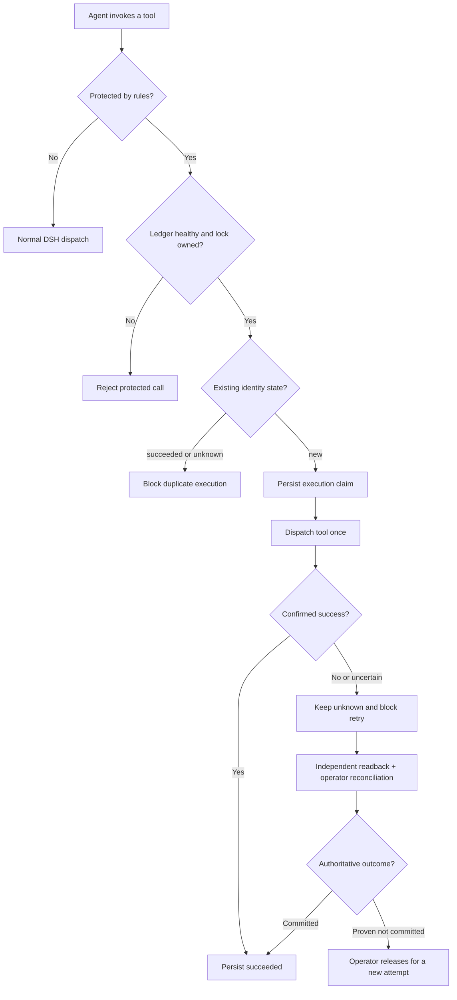

<h1 align="center">SKY Evidence Recovery</h1>

<p align="center"><strong>Durable evidence-backed recovery for opt-in DeepSeek Harness tools</strong></p>

<p align="center">
  <a href="docs/RELEASE_NOTES.md"></a>
  
  
  <a href="LICENSE"></a>
  
</p>

<p align="center">
  <a href="README.en.md">English</a> ·
  <a href="README.md">简体中文</a> ·
  <a href="README.ko.md">한국어</a> ·
  <a href="README.ja.md">日本語</a>
</p>

**DeepSeek Harness(DSH)** 도구를 위한 경량 실행 보호 플러그인입니다. 보호 대상 도구를 호출하기 **전에** 작업 식별 정보를 영구 기록합니다. 응답 손실·시간 초과·예외로 실행 결과가 불확실한 경우 동일 작업의 무분별한 재실행을 차단하고, 독립적인 결과 조회와 운영자 확인을 통해 다음 작업을 결정합니다.

**Exactly-once 실행은 보장하지 않습니다.** `rules`에 명시된 도구만 보호하며, 기본 설정인 `rules: []`는 어떤 도구도 보호하지 않습니다.

## 주요 기능

- **영속 실행 원장:** 작업 식별자 해시, 인수 지문, 실행 시도와 상태를 저장하여 재시작 후에도 확인할 수 있습니다.
- **중복 실행 방지:** 확실히 성공한 작업은 `succeeded`, 결과가 불확실한 작업은 `unknown`으로 유지하고 재시도를 차단합니다.
- **오류 시 안전한 차단:** 원장이나 잠금이 손상되거나 이용할 수 없으면 보호 대상 호출을 거부합니다.
- **증거 기반 복구:** 신뢰할 수 있는 운영자가 외부 시스템에서 결과를 확인한 뒤 오프라인으로 대조합니다. 도구의 오류 코드만으로 미실행을 판정하지 않습니다.
- **상태 확인:** `sky_recovery_health`, `sky_recovery_status`로 플러그인 및 원장 상태를 확인합니다.

## 설치 및 테스트

DSH 0.2 사전 출시 계열(아래 검증 버전 참조) 및 Node.js ≥24.9.0이 필요합니다. 격리된 프로필에 설치합니다.

```powershell
dsh plugin --profile sky-evidence-smoke add "file:$($PWD.Path)"
```

설치 직후에는 `rules: []`이므로 보호가 활성화되지 않습니다. 실제 사용하려는 도구를 명시적으로 설정해야 합니다.

```yaml
- id: sky-evidence-recovery
  config:
    rules:
      - tool: sky_demo_create_order
        keyArg: requestId
```

예시에는 제공된 `sky-evidence-recovery/demo` 도구도 필요합니다. Windows에서 `启动DSH测试.cmd`를 실행하면 **격리된 설정 사전 검사**만 수행하며, Web은 기본적으로 시작하지 않습니다. 실행 후 `sky_recovery_health`를 직접 호출하여 `loaded=true`, `ledgerLocked=true`, `protectedTools`에 대상 도구가 포함되는지 확인하세요.

<details>
<summary><strong>기술 흐름도와 설계 설명 펼치기</strong></summary>



- 도구 본문 실행 전에 작업 식별 정보를 영구 기록합니다.
- 확정 성공만 `succeeded`로 처리하며, 결과가 불확실하면 `unknown` 상태를 유지합니다. 읽기 전용 조회가 잠금을 자동 해제하지는 않습니다.
- 신뢰할 수 있는 운영자가 별도의 근거로 실제 결과를 확인한 뒤 오프라인 대조를 수행합니다. 제출되지 않았고 지연 제출 가능성도 없을 때만 재실행을 허용합니다.
- 플러그인이 로드되지 않으면 자체적으로 보호할 수 없으므로, DSH 호스트에서 보호 대상 도구의 활성화를 별도로 통제해야 합니다.

</details>

## 검증 범위

2026-11-05 최종 검증은 공개 버전 `0.1.1`과 **동일한 실행 로직**의 내부 후보 `0.1.4-beta.1`을 대상으로 수행되었습니다. 추적을 위해 원본 검증 보고서의 버전과 해시를 유지합니다.

| 항목 | 결과 |
|---|---|
| Windows `npm run check` | 46 PASS, 0 FAIL, 0 SKIP |
| Windows PowerShell 5.1 / CMD | 7 PASS |
| 실제 DSH ToolRuntime | 중복 제거 기준 91개 검증 PASS, R30 호환성 테스트 BLOCKED |
| 실제 Web 모델 A–E | 5개 시나리오 PASS, 실제 도구 호출 10회 |
| npm 패키지 사전 검사 | PASS, 런타임 파일 13개 |

R16의 실제 런타임 디스크 오류 주입, macOS/Linux, 다중 프로세스·다중 호스트, 실제 업무 시스템 및 갑작스러운 전원 차단은 검증하지 않았습니다. 수치는 외부 검증 보고서에 따른 것이며 모든 원본 세션은 공개되지 않습니다. [최종 검증 보고서](docs/FINAL_TEST_REPORT.md)(중국어) 참고.

## 보안 제한과 문서

Agent에 동일 시스템 계정의 임의 shell·파일 쓰기·플러그인 관리 권한을 부여하면 원장을 우회할 수 있습니다. 호스트의 플러그인 활성화 검사가 필요합니다. 지원 범위는 명시적으로 지정한 도구 및 단일 프로세스 로컬 원장입니다.

[보안 범위](docs/SECURITY.md) · [문제 및 수정 기록](问题与修复记录.md)(중국어) · [릴리스 노트](docs/RELEASE_NOTES.md) · [코드 규칙](DSH_PLUGIN_CODE_STANDARDS.md) · [Apache-2.0](LICENSE)

**안내:** DeepSeek가 공식 제공하거나 보증하는 플러그인이 아닌 독립 커뮤니티 프로젝트입니다.
