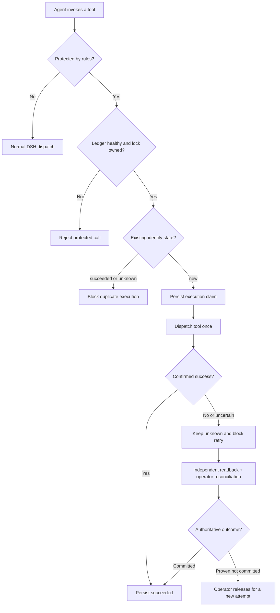

<h1 align="center">SKY Evidence Recovery</h1>

<p align="center"><strong>Durable evidence-backed recovery for opt-in DeepSeek Harness tools</strong></p>

<p align="center">
  <a href="docs/RELEASE_NOTES.md"></a>
  
  
  <a href="LICENSE"></a>
  
</p>

<p align="center">
  <a href="README.en.md">English</a> ·
  <a href="README.md">简体中文</a> ·
  <a href="README.ko.md">한국어</a> ·
  <a href="README.ja.md">日本語</a>
</p>

面向 **DeepSeek Harness（DSH）** 的轻量执行保护插件：在受保护工具产生副作用**之前**持久记录操作身份；如果成功回执丢失、发生超时或执行结果不确定，阻止 AI 盲目重试。通过独立回读和人工对账，决定是否允许后续操作。

**它不是让 AI 永不犯错的工具，也不承诺 exactly-once。** 仅明确写入 `rules` 的工具受保护；默认空规则不保护任何工具。

## 快速入门

1. 解压与安装版本匹配的完整源码。在源码目录运行 `dsh plugin --profile sky-evidence-smoke add "file:$($PWD.Path)"`。
2. 在隔离 Profile 中[配置一条规则](#安装与试跑)。启动后调用 `sky_recovery_health`，确认已加载、账本已锁定、`invalidRules: []` 且目标工具在保护清单内。
3. 遇到 `SKY_EXECUTION_UNKNOWN`，从受信任的操作者终端运行 `node admin.js list --pending --data-dir $ledgerDir`，再按[操作者恢复](#操作者恢复)核实下游并预览对账。

## 核心能力

- **持久执行账本：** 记录业务标识哈希、参数指纹、执行代次及结果状态，重启后仍可核查。
- **重复副作用拦截：** 明确成功标为 `succeeded`；取消、超时、异常、回执丢失等不确定状态保留 `unknown`。
- **故障时拒绝执行：** 账本不可用、锁损坏或所有权变化时，对受保护调用返回拒绝，不自动解除。
- **独立证据对账：** 操作者核实下游真实状态后，可离线确认已提交或确实未提交。工具自身错误码不能证明未执行。
- **运行时检查：** `sky_recovery_health` 和 `sky_recovery_status` 提供加载、保护规则与账本状态查询。

## 安装与试跑

要求：DSH 0.2 预发布系列（实测版本见下方）、Node.js ≥24.9.0；在隔离环境中安装并配置。

```powershell
dsh plugin --profile sky-evidence-smoke add "file:$($PWD.Path)"
```

默认 `cordis.patch.yml` 为 `rules: []`，**安装不等于已经启用保护**。启用时按实际工具配置规则，例如：

```yaml
- id: sky-evidence-recovery
  config:
    rules:
      - tool: sky_demo_create_order
        keyArg: requestId
```

此示例需同时启用随附的 `sky-evidence-recovery/demo` 模拟工具。Windows 可双击 `启动DSH测试.cmd` 执行**隔离配置预检**；不会默认启动 Web。启动后实际调用 `sky_recovery_health`，确认 `loaded=true`、`ledgerLocked=true`、`invalidRules=[]`、`protectedTools` 含目标工具。详见 [DSH 接入验收](DSH_接入验收.md)。

## 操作者恢复

从与安装版本匹配的完整源码 ZIP 运行 `admin.js`。它随源码分发，运行时 bundle 不包含它。把 `$ledgerDir` 设为本次 DSH 配置的账本目录。

| 看到的状态 | 接下来做什么 |
| --- | --- |
| `SKY_ALREADY_EXECUTED` | 回读已有结果。 |
| `SKY_EXECUTION_UNKNOWN` | 查询待处理记录，独立核查下游。 |
| `SKY_KEY_CONFLICT` | 核对原业务标识与参数。 |
| `SKY_LEDGER_UNAVAILABLE` 或 `SKY_INVALID_RULE` | 检查健康状态、规则和账本锁。 |

```powershell
node admin.js list --pending --data-dir $ledgerDir
node admin.js inspect --record-id $recordId --data-dir $ledgerDir
```

清单中的 `recordId` 是账本记录哈希，`executionId` 是本次执行代次。`recordedState: running` 表示执行可能仍在途或已经中断，`legacyRelease: true` 表示旧版仅凭错误元数据释放过记录。两者的有效状态都是 `unknown`。如果 `complete: false`，命令退出 2，`errors` 列出无法读取的记录 ID。该清单是只读视图，服务运行期间可能变化。

正式对账前，停止 DSH 和可能仍在执行的下游任务，用独立权威来源核实。将原始工具参数写入私有 `args.json`。证据文件 `evidence.json` 包含 `source`、实际核查时刻 `observedAt`（ISO 8601）和 `summary`。核查时间须覆盖该记录的最新更新。用 `committed` 确认已提交，仅在证明确实未提交且不会迟到提交时用 `not_committed`。

```powershell
$review = @(
    '--data-dir', $ledgerDir, '--tool', 'sky_demo_create_order', '--key-arg', 'requestId',
    '--args-file', 'args.json', '--execution-id', $executionId,
    '--decision', 'committed', '--evidence-file', 'evidence.json'
)
node admin.js reconcile @review --dry-run
# Set $previewToken to the previewToken returned above.
node admin.js reconcile @review --expect-preview $previewToken --confirm I_VERIFIED_READBACK
```

先核对预览中的 `recordId`、`executionId` 和 `nextState`。正式对账取得独占锁后会重新校验证据与预览；如果记录或证据变化，重新核查并预览。错误码只用于诊断，不能作为独立证据。

<details>
<summary><strong>技术流程图与设计解释（点击展开）</strong></summary>



- 记录发生在工具派发**之前**；相同业务身份若已有成功或未知状态，就拒绝重复副作用。
- 只有明确成功才结算为 `succeeded`，其余不确定情形默认 `unknown`；只读回读**不会自动解锁**。
- 对账只允许可信操作者在停止服务并独立核实下游状态之后进行。只有证明既未提交也不会迟到提交，才能允许新一次执行。
- 插件未加载时无法自保；宿主必须单独保证关键工具不会在缺少保护时启动。

</details>

## 已验证范围

**当前 `0.1.2` 外部复测：** Windows `npm run check` **51/51 PASS**，真实 DSH `tools.execute` **89/89 断言 PASS**，管理 CLI 的待处理清单与对账预览已做真实账本冒烟；Windows 验收的 npm 运行时包为 **13 文件**；本次 Linux / npm 10 检查为 **16 文件**（多出三份语言 README，不含管理 CLI）。本版 **已补跑真实 Web 模型 A–E：5/5 场景、10 次真实 tool/call**（[补跑记录](docs/A-E_rerun_0.1.2.md)），R30 社区插件组合仍 BLOCKED，R16 运行时结算写盘故障注入未验证。详细过程与报告来源见 [问题与修复记录](问题与修复记录.md)。

以下表格专属历史 `0.1.1`：首次公开版 `0.1.1` 对应的内部候选 `0.1.4-beta.1` 的历史验收，保留原版本及哈希以便追溯。

| 检查 | 实测结果 |
|---|---|
| Windows `npm run check` | 46 PASS，0 FAIL，0 SKIP |
| Windows PowerShell 5.1 / CMD | 7 PASS |
| 真实 DSH ToolRuntime | 91 条去重断言 PASS，R30 兼容性测试 BLOCKED |
| 真实 Web 模型 A–E | 5 场景 PASS，10 次真实工具调用 |
| 打包检查 | `npm pack --dry-run` PASS，运行时包 13 文件 |

未完成 R16 的真实运行时磁盘结算失败注入；macOS/Linux、多实例、跨机部署、真实业务系统及强制断电恢复未验证。结果依据验收方报告，并非所有原始会话日志都随仓库公开。见 [最终验收报告](docs/FINAL_TEST_REPORT.md)。

## 安全边界与文档

**生产部署必须隔离 Agent 权限**：如果智能体拥有同系统身份下的任意 shell、文件写入或插件管理权限，它可能绕过账本。插件缺席时也不能自动保护其他工具。仅支持已配置工具和单进程本地账本；不承诺 exactly-once。

[安全声明](docs/SECURITY.md) · [完整问题与修复记录](问题与修复记录.md) · [发布说明](docs/RELEASE_NOTES.md) · [开发规范](DSH_PLUGIN_CODE_STANDARDS.md) · [Apache-2.0](LICENSE)

**声明：** SKY Evidence Recovery 是独立社区项目，非 DeepSeek Harness 官方插件，不代表 DeepSeek 官方背书。
